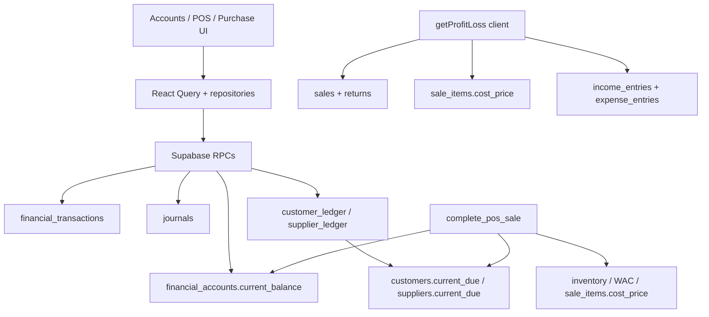

# REPORT 2 — Complete Current System Architecture

**Status:** VERIFIED unless marked otherwise  
**Audit date:** 2026-11-18  

## Repository discovery matrix

| Area | Actual implementation | Main files | Dependencies | Confidence |
|---|---|---|---|---|
| Frontend | React + Vite + TypeScript | `src/` | React Router, TanStack Query, shadcn/ui | VERIFIED |
| Router | Nested `RouteObject` modules | `src/app/routes/*.tsx`, `accounts.routes.tsx` | `PermissionRoute` | VERIFIED |
| Backend | Supabase Postgres RPCs (no separate Node API for accounts) | `supabase/migrations/*.sql` | PostgREST + RLS | VERIFIED |
| Database | Postgres via Supabase | migrations `20260315000*` | WAC, journals, FT, party ledgers | VERIFIED |
| Authentication | Supabase Auth + session context | `src/features/auth/auth-session.tsx` | org/branch membership | VERIFIED |
| RBAC | Permission strings + UI gates + SQL `user_has_permission` | `src/lib/permissions/catalog.ts` | role_permissions | VERIFIED |
| Accounts | Simple retail accounting feature | `src/features/accounting/**` | `simple-accounting.repository.ts` | VERIFIED |
| Sales / POS | Feature modules + POS RPCs | `src/features/sales/**`, `src/features/pos/**` | `complete_pos_sale` | VERIFIED |
| Purchases | Feature + RPC | `src/features/purchases/**` | `complete_purchase`, `pay_supplier` | VERIFIED |
| Inventory | Stock + WAC + provenance | `src/features/inventory/**` | `_adjust_inventory`, balances | VERIFIED |
| Customers / Suppliers | Admin + due fields | `src/features/customers/**`, `suppliers/**` | `current_due` | VERIFIED |
| Reporting | Reports hub + dashboard RPC | `src/features/reports/**`, `dashboard/**` | `get_dashboard_overview` | VERIFIED |
| State/cache | React Query | `src/lib/query/keys.ts`, `party-finance-cache.ts` | invalidation after money moves | VERIFIED |
| Testing | Vitest + Playwright + SQL smoke | `src/**/*.test.ts`, `e2e/`, `supabase/tests/` | accounts FE tests sparse | VERIFIED |

## Module map (Accounts & Finance)

```
Accounts UI (simple)
├── Dashboard          /accounts
├── Cash & Bank        /accounts/cash-bank
├── Income             /accounts/income
├── Expenses           /accounts/expenses
├── Customer Due       /accounts/customer-due
├── Supplier Due       /accounts/supplier-due
├── Due Collection     /accounts/collections  → sales DueCollectionPage
├── Supplier Payment   /accounts/supplier-payments → purchases SupplierPaymentsPage
├── Daily Closing      /accounts/daily-closing
├── Transactions       /accounts/transactions
├── Profit & Loss      /accounts/profit-loss
├── Reconciliation     /accounts/reconciliation
└── Account Settings   /accounts/settings
```

## Branch isolation model

| Rule | Evidence | Confidence |
|---|---|---|
| Active branch from auth session drives FA list filter | `listFinancialAccounts(branchId)` uses `.or(branch_id.eq.X, branch_id.is.null)` | VERIFIED |
| Org-wide FA (`branch_id` null) visible to all branches | same | VERIFIED |
| Money RPCs require `branch_id` + branch access | income/expense/transfer/collect/pay/close SQL | VERIFIED |
| Payment may use FA not matching sale branch | POS FA checks org+active, not FA.branch match | VERIFIED |

## Accounting source of truth (layers)

1. **Cash/bank balance SSOT:** `financial_accounts.current_balance` (stored), updated by locked balance adjuster / `_post_financial_txn`.  
2. **Cash-book trail:** `financial_transactions` (+ `balance_after`).  
3. **Accrual/journal layer:** journal entries/lines via `_post_journal` (hybrid).  
4. **AR/AP SSOT:** `customers.current_due` / `suppliers.current_due` maintained by `_post_*_ledger_entry`.  
5. **Document open due:** `sales.due_total` / purchase due fields used by FIFO allocation.  
6. **P&L (Accounts UI):** **derived client-side** from `sales`, `sale_returns`, `sale_items.cost_price`, `income_entries`, `expense_entries` — not a single SSOT RPC.

## Financial tables (core)

| Table / concept | Role |
|---|---|
| `financial_accounts` | Cash/bank/mobile wallets; opening + current balance |
| `financial_transactions` | Cash-book movements |
| `income_entries` / `expense_entries` + categories | Operating income/expense docs |
| `customer_ledger` / `supplier_ledger` | Party history |
| `customers` / `suppliers` | `current_due` (and customer advance) |
| `payment_allocations` | FIFO collection/payment allocation |
| Journals / journal lines | Double-entry companion |
| Daily closing tables (via `close_business_day`) | Day close records |
| Recon views / RPCs | Integrity diagnostics |

## Permissions (accounts-related)

From `src/lib/permissions/catalog.ts` (VERIFIED):  
`accounts.read|post|manage|period_override`, `income.create`, `expense.create|approve`, `customer_due.collect`, `supplier_due.pay`, `transactions.void`, `daily_closing.create|approve`, `profit_loss.read`, `account_settings.manage`, `reconciliation.read|run|apply`, plus legacy `accounting.view|post`.

Parent route: all `/accounts/*` behind `PermissionRoute permission="accounts.read"` (`accounts.routes.tsx`).

## Data flow (high level)



## Related prior documentation

- `docs/unified-core-implementation-report.md` — journals, FT, recon dry-runs, historical opening gaps  
- `docs/LEGACY_MODULES.md` — legacy module notes (if present)  

## Quality gate status

| Gate | Status |
|---|---|
| Accounts routes discovered | PASS |
| Frontend components inspected | PASS |
| Backend services traced | PASS |
| Financial tables identified | PASS |
| Runtime production balances sampled this session | **BLOCKED** (no authorized read-only DB session used) |
